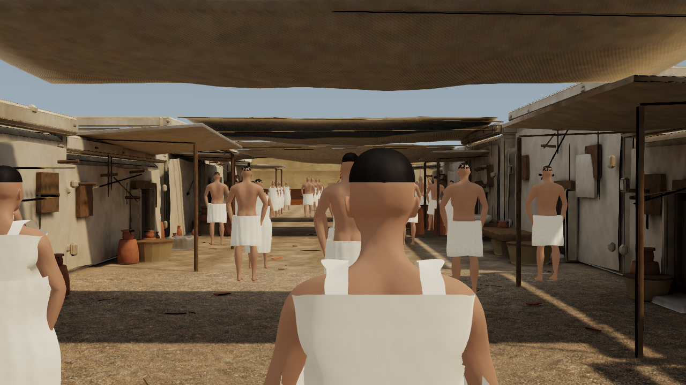
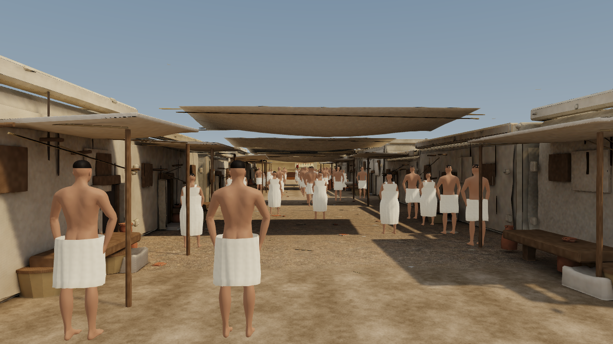
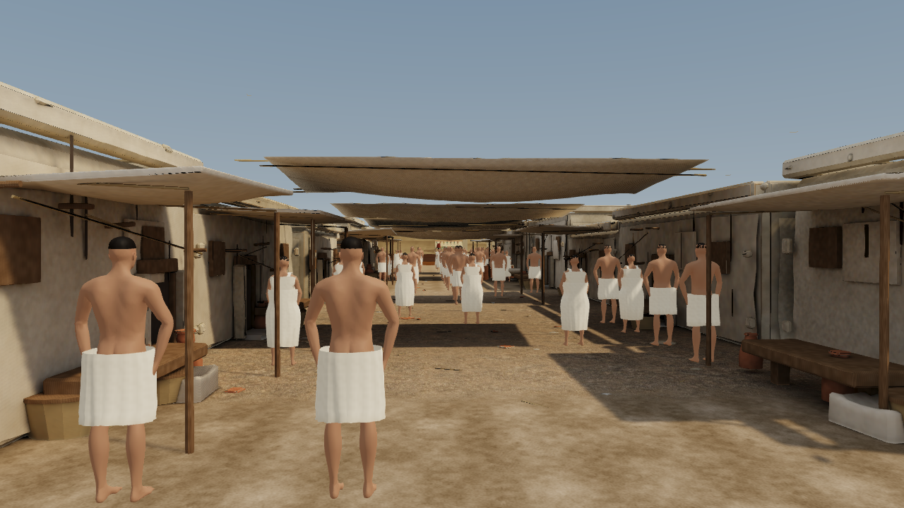
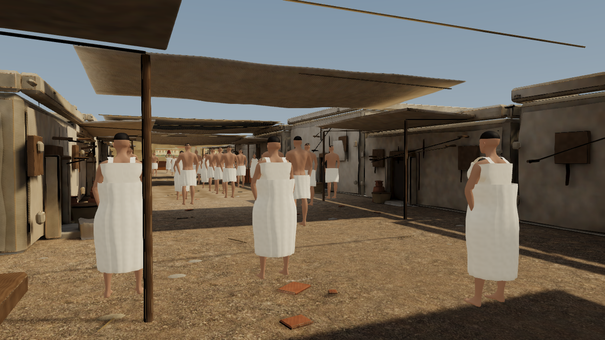
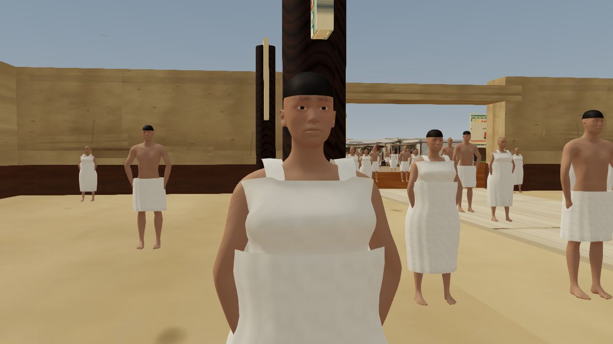
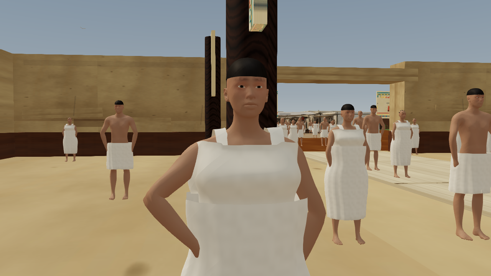
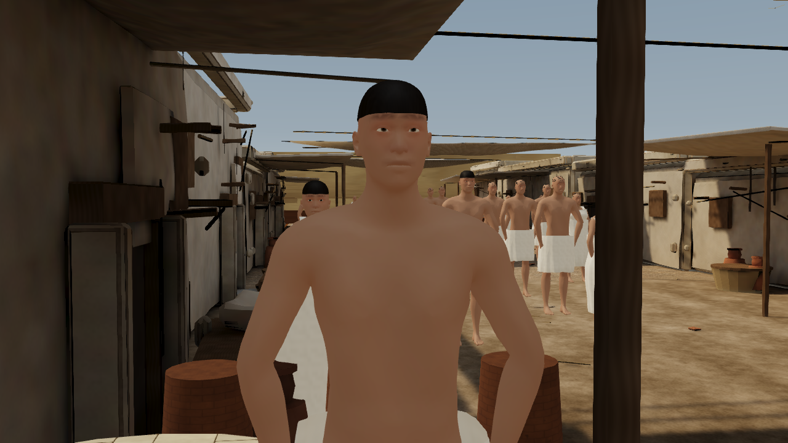

# Character actions and motion: steps 5–6 — 27 October 2026

The user clarified the next two character steps: **5 replaces generic arm gestures with specific asymmetric actions, including preparation/contact/work/return phases; 6 improves whole-body motion, blinks and transitions, with a measured small-group GPU interpolation prototype.** Appearance variety is not part of this pass. These definitions supersede the older street roadmap's step numbers.

## Delivered presentation changes

The shared action vocabulary now includes one-handed inspection, a brief conversational/greeting gesture, restrained resting poses and a return to relaxed arms. The dominant side varies deterministically. Four-second authored cycles have eased preparation, a short working interval, a return and at least 1.65 seconds of relaxed posture. The existing stoneworker uses the same phased work envelope at the original block, keeping the existing tool and support hand. The carrier retains the existing load-support contact rather than performing an unrelated free-hand gesture.

Live residents can place a hand on a reachable object. The resolver casts against visible static triangles and checks the top normal, height and anatomical reach. It caches real surface hits, never uses invisible collision helper planes or fabricates a contact point. A restrained knee/hip bend and torso coordination assist low surfaces with feet under the existing IK solver. Wrist goals compensate for the hand length and receive a small endpoint correction. Missing, unsupported or unreachable props produce a brief observation gesture followed by relaxation. No resident is moved closer to manufacture a successful contact.

The GPU background crowd receives the asymmetric shared action clips and relaxed pauses. It does **not** gain per-person object IK, pickup/drop inventory or physical object ownership. Its observational gestures should not be described as verified object contact. This distinction preserves performance and prevents unsupported two-hand work holds at inaccessible stations.

Pelvis shifts, shoulder counter-motion, restrained head movement and periodic idle clips replace a completely fixed idle. The existing skin eyelid rims close over the original eyes with independent blink phases; no eyeball scaling, transparent overlay, additional texture or draw call is used. Existing anatomy, garment geometry, materials, UVs and rigs are unchanged on disk.

## GPU transition prototype

The original crowd selected nearest frames and five locomotion/three action blend levels. The new shared atlases use seven locomotion levels, four action levels, 64 walking frames and 48 action frames. Idle motion is sampled across a periodic four-second loop. Two pose textures remain; rows increase from 608 to 1,219 per texture, including three spare rows per sex.

At most six nearby GPU residents (the nearest three of each sex, within 20 metres) receive continuous CPU interpolation of existing bone matrices into spare texture rows. Partial row uploads preserve the same GPU skinning shader, sampler count and nine live skeletons. Residents beyond this bounded prototype use the richer shared discrete atlas. This is a measured prototype, not a rollout of per-person animation solvers to all 117 GPU residents. The row upload ceiling is 62,976 bytes/frame when all six slots are active. Stable slot assignment avoids unnecessary reassignment when distance ordering changes slightly.

The isolated interpolation pilot (same final presentation, interpolation disabled versus six nearby residents enabled) measured 39.2 → 39.2 ms median and 66.7 → 69.6 ms p95 in one paired full-tour run. This single pair supports retaining the bounded pilot; it is not a statistically established speedup or a basis for scaling to all residents.

Final full-tour measurements use the complete accepted steps1–4 as control and complete steps5–6 as final: physical Intel HD4600 / D3D11, 1280×720, three alternating pairs per tier, 300 simulated seconds crowd warmup, 600 tour frames with the first 61 excluded (539 measured intervals/run). Values are medians of the three run percentiles:

| Tier | Median before → after | p95 before → after | Change median / p95 |
|---|---:|---:|---:|
| Balanced | 40.3 → 39.9 ms | 67.1 → 69.1 ms | −1.0% / +3.0% |
| Cinematic | 62.4 → 59.2 ms | 124.8 → 115.3 ms | −5.1% / −7.6% |

Both remain within the inherited 10% budget. Run-to-run desktop variation is visible; do not generalize these results as a guaranteed speedup. Neither tier is a steady 30 FPS on this hardware. The canonical view retains 391 draws, 1,311 meshes and 2,914,332 reported scene vertices. Geometry and surface texture downloads are unchanged. Pose atlas RGBA32F storage increases from about 12.17 to 24.40MiB (+12.23MiB); the capture's generic texture estimator only reports 388.44→392.52MiB because it assumes a common byte format. Use the explicit float-texture calculation for pose memory.

The final 30-second 60 Hz presentation audit recorded 120 stoneworker contact-goal samples, maximum goal error 7.8 mm, maximum wrist angle 0.610 rad,32,400 live-foot planted samples with maximum solver error 5.9 mm, and 10,800 interpolated resident samples (six per update). No additional station contacts occurred in that sample; the real-triangle bench contact/reach/missing-object cases pass the independent geometry fixture. These metrics do not prove individual object IK or live foot IK for all GPU residents. The ten-minute full-density audit passed every behavior check: 63/63 participants completed tasks, 555 completions, no zone/building violations, 65 cm clearance and bounded forward-facing turns.

[Machine-readable summary](character-actions-steps-5-6-2026-10-27.json) · [lossless raw evidence index](performance/character-action/index.json). Five matched static pairs, two 30-second previews, blink inspections, individual timings and exact source phase hashes are retained.

## Position, behavior and asset locks

All 126 residents and 63 task brains remain. DistrictLife differs only by two presentation-metadata assignments: the current action's station and its visual start time. The validator reconstructs the entire previous movement/decision source exactly after removing those assignments. Eighty-eight other original source/data/asset files are hashed unchanged, including camera bookmarks, route data, navigation, profiles, coordination, geometry, maps, bind rigs and collision sources. Actor roots and standing points are not translated by the new presentation. Pelvis and limb posing changes are intentional.

The new bounded character-action revision preserves all previous art/surface records and their immutable snapshots. Its explicit five-file baseline covers the two actor-presentation sources, DistrictLife and the two preceding surface guards. The current action validator independently checks source additions, reconstruction and locked files. Do not overwrite older revision records to accept changes.

## Matched views and motion

| View | Before | After |
|---|---|---|
| Street |  |  |
| Entry |  |  |
| Material view |  |  |
| Female |  |  |
| Male |  |  |

[Before 30-second route preview](screenshots/hero-street-main-character-actions-30s-before.motion.webp) · [After 30-second route preview](screenshots/hero-street-main-character-actions-30s-after.motion.webp). These follow the same existing review route over 900 simulation frames. Browser compositor frames can be dropped; the animated previews are inspection evidence, not FPS measurements. Temporary review instrumentation is restored by SHA-256 after capture. The route and permanent cameras are unchanged.

Additional face inspection: [open eyelids](screenshots/hero-street-main-character-actions-blink-open.png), [closed eyelids](screenshots/hero-street-main-character-actions-blink-closed.png).

## Reproduction

```powershell
node tools/record-character-actions.mjs
npm run validate:character-actions
npm run build
node tools/capture-hero-shot.mjs character-actions-motion-audit --hardware --audit-script=tools/audit-character-actions.js
node tools/capture-character-actions-motion.mjs
node tools/benchmark-character-actions.mjs --prototype-comparison --crowd-warmup --runs=1 --label=character-action-prototype
node tools/benchmark-character-actions.mjs --crowd-warmup --runs=3 --label=character-action-tour
node tools/benchmark-character-actions.mjs --crowd-warmup --runs=3 --quality=cinematic --label=character-action-cinematic
```

Run captures, benchmarks and builds sequentially. Comparison tools swap only the three presentation runtime sources and restore exact final buffers in `finally`; benchmark camera instrumentation is also restored. Keep the inherited Intel HD4600 target and 10% regression budget. Headset testing remains deferred. Original Blender/CC0 glTF sources, PBR maps and rig/scale conventions remain available. The procedural action recipe, eye-rim deformation and browser pose-texture playback require engine-specific animation integration for Unity/Unreal. No deployment is performed.
