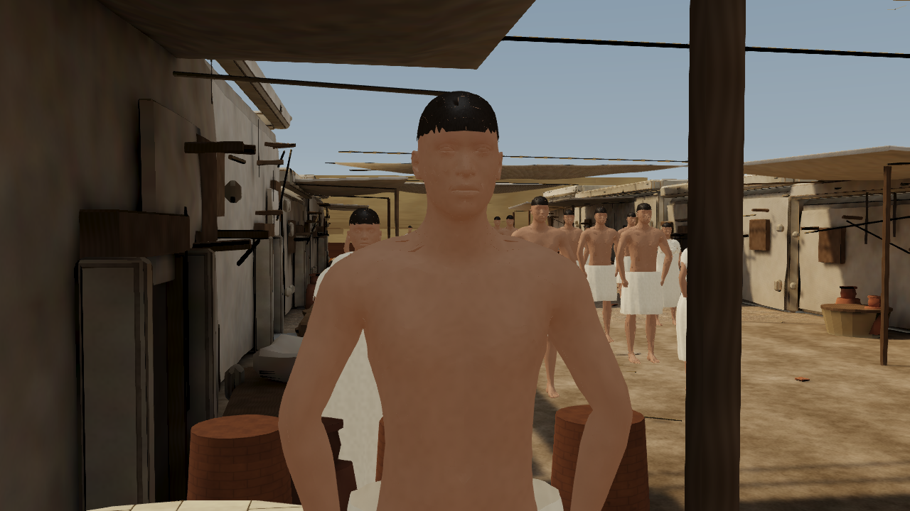
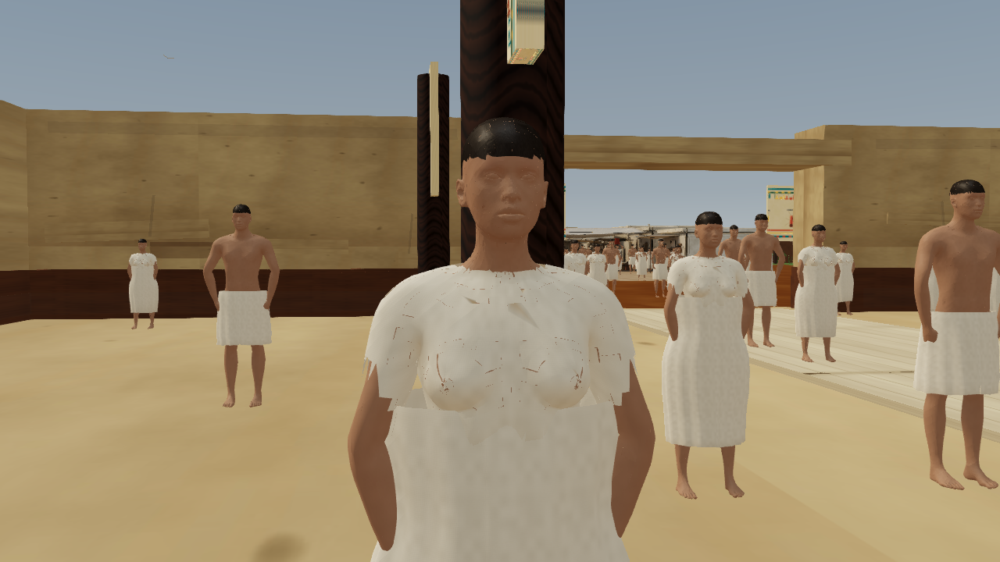
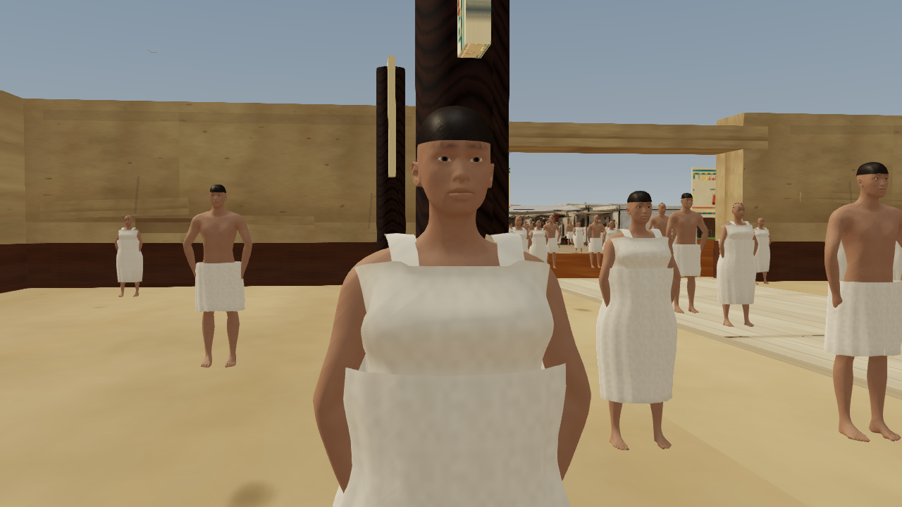
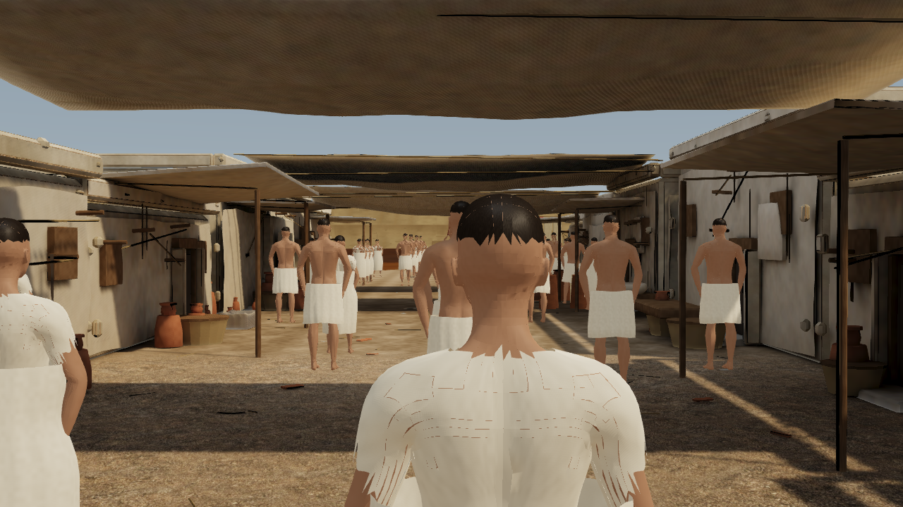
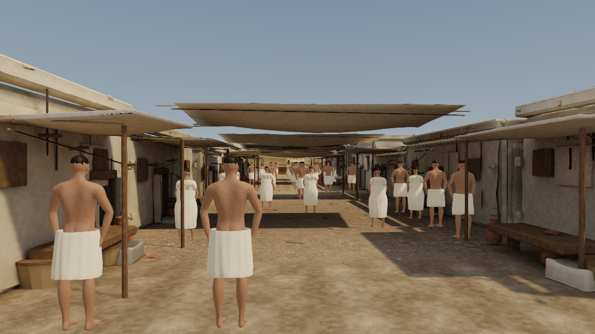
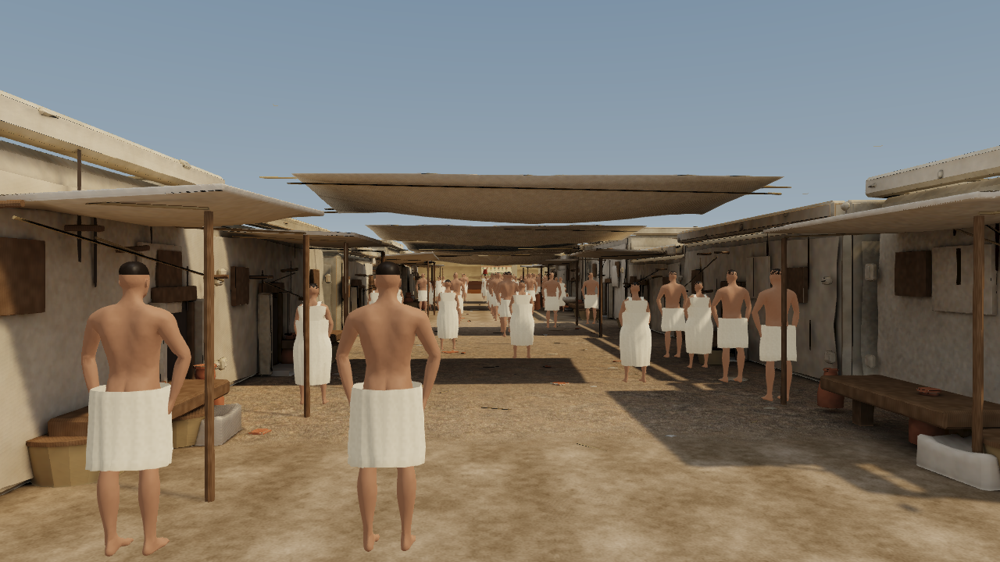
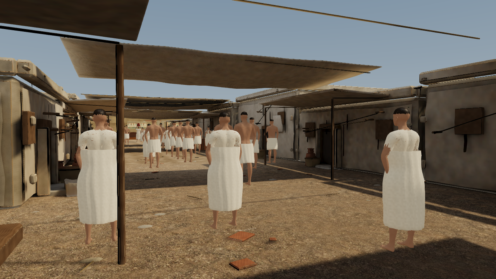
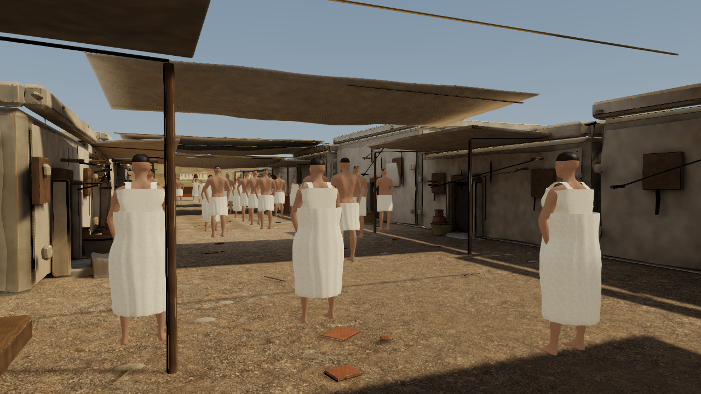

# Character realism: steps 1–2 — 27 October 2026

The two approved steps repair garment coverage and establish connected male/female reference anatomy. Population (126), 63 task participants, actor placements, navigation, district geometry, collision and stored cameras remain unchanged. No deployment was performed.

## What changed

**Step 1 — clothing integrity.** Replaced the female bodice copied from damaged body faces with a continuous torso loft and two shoulder straps. Added bounded waist clearance to the existing wrap, preserving its length, UVs and weights. Removed only concealed body triangles; retained any candidate triangle exposed by the seven tested poses per sex. Editable Blender files and exact removed-face records are included.

**Step 2 — connected reference anatomy.** Investigation found thousands of open seams in the previously reduced anatomy, including the face. The glTF import had retained separate vertices before decimation. Rebuilt both reference bodies from the original CC0 sources with merged vertices before reduction, cleared stale split normals and restored smooth connected surfaces. Both full reference bodies have zero boundary edges before deliberate concealed-body removal. Existing 163-joint rigs, inverse binds and actor nodes are preserved. Rebuilt the cropped scalp from connected head geometry; separated opaque eyes from the skin material and added restrained eye, brow and lip vertex colour definition. Refreshed all four crowd LODs.

This is a repaired base for subsequent art passes, not reference-level photorealism. Face proportions remain based on the original CC0 anatomy. Skin detail, hairstyle variety, richer cloth drape and detailed hand interactions remain future work. Finite pose coverage checks do not guarantee every possible motion or simulate physical cloth.

## Matched comparisons

Three stored views use identical cameras, viewport and animation time. Portraits use temporary inspection cameras and identical actor roots, targets and fields of view; stored tour cameras are untouched.

| View | Before | After |
|---|---|---|
| Male reference |  |  |
| Female reference |  |  |
| Hero street |  |  |
| Entry |  |  |
| Material view |  |  |

Additional final inspections (not before/after pairs): [female side](screenshots/hero-street-main-character-female-side.png), [female back](screenshots/hero-street-main-character-female-back.png).

## Performance

Physical Intel HD 4600 / D3D11, 1280×720. Three alternating before/after pairs per tier; 300 simulated seconds crowd warmup, 600 tour frames, first 61 excluded (539 intervals/run). Both conditions retain the same current rendering/controller/AI; only eight character asset/manifest files are swapped. SHA-256 phase logs prove which bytes were used. Values below are medians of the three run percentiles, in milliseconds; lower is better.

| Tier | Median frame before → after | p95 before → after | Change median / p95 |
|---|---:|---:|---:|
| Balanced | 47.7 → 39.9 ms | 81.1 → 67.3 ms | −16.4% / −17.0% |
| Cinematic | 67.5 → 57.6 ms | 123.9 → 111.4 ms | −14.7% / −10.1% |

Hero GLB downloads: 3,989,432 → 2,609,972 bytes (−34.6%); combined close character triangles: 63,805 → 57,896. No new image textures. Nine live rigs plus 117 GPU instances and two 608-row pose textures remain. Frame pacing still falls short of a steady 30 FPS on this hardware, particularly in cinematic mode. Headset testing remains deferred.

## Validation and reproduction

Full `npm run build` passed, including existing layout/camera/collision integrity guards, historical revisions and current character-art validation. Fourteen pose cases (neutral, both strides, bent knees, reach, lift and torso turn per sex) report zero outward coverage-ray misses. A ten-minute full-density live audit passed all ten behavior checks: 63/63 task residents completed tasks, 555 completions total. Rig/bind/UV/weight checks and refreshed LOD source hashes pass.

Use Blender 5.1. `CHARACTER_ART_BLENDER_BIN` may specify its executable. `npm run build:people` and `npm run build:character-art` use the corrected import pipeline. Keep immutable character-art baseline snapshots and older revision records. Historical tests read their exact archived asset bytes through the bounded revision adapter; `validate:character-art` independently validates current runtime assets and source hashes.

```powershell
npm run build:character-art
npm run build
node tools/benchmark-character-art.mjs --crowd-warmup --runs=3 --label=character-art-tour
node tools/benchmark-character-art.mjs --crowd-warmup --runs=3 --quality=cinematic --label=character-art-cinematic
node tools/report-character-art.mjs
```

Run benchmark/capture instrumentation sequentially; it temporarily swaps assets and restores original bytes in `finally`. Existing matched PNGs and exact raw measurement JSONs are retained: [summary](character-art-steps-1-2-2026-10-27.json), [lossless gzip archive index](performance/character-art/index.json). Each archive records original SHA-256 and byte counts. Source GLBs, editable `.blend` files, original PBR maps, scale and provenance remain available for later Unity/Unreal adaptation; runtime shaders and animation playback need engine-specific integration.
