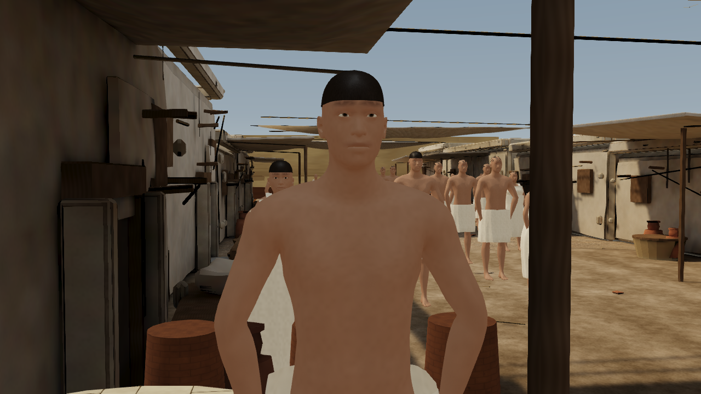
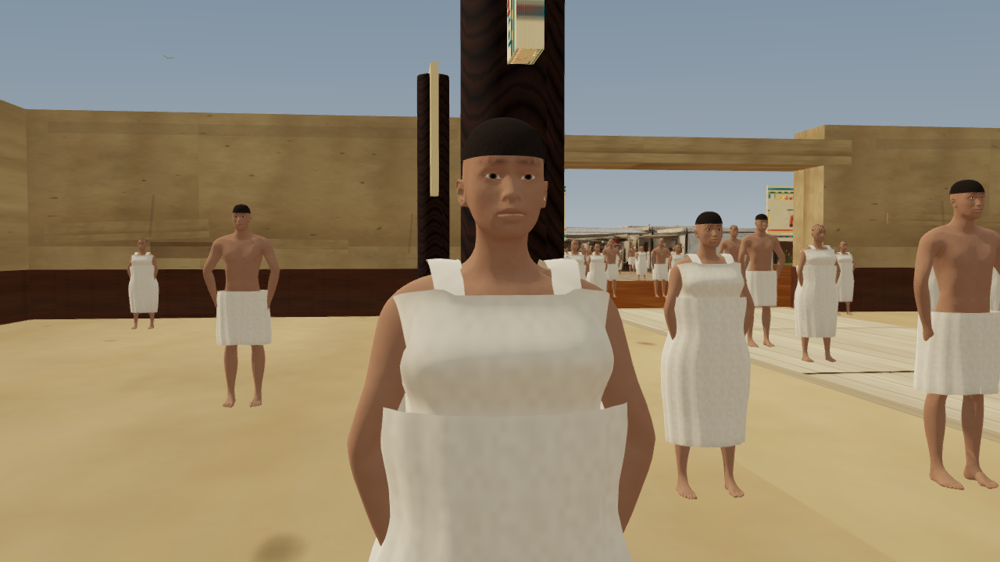
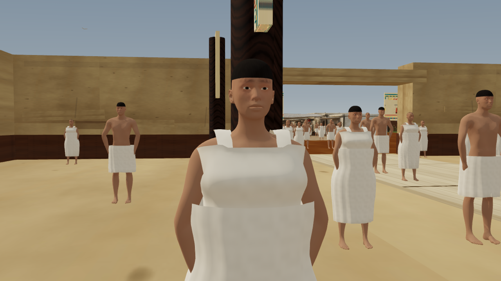
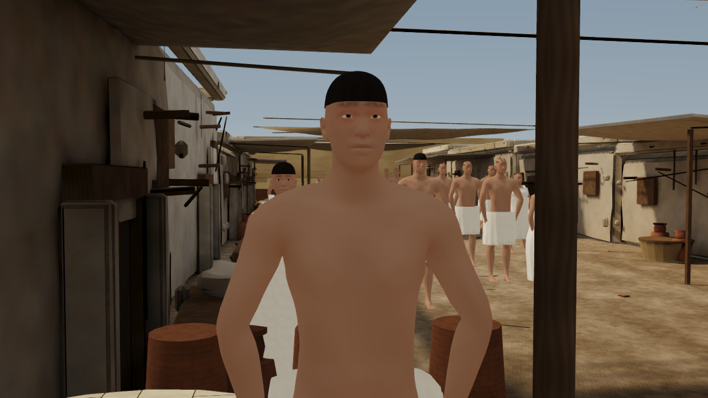
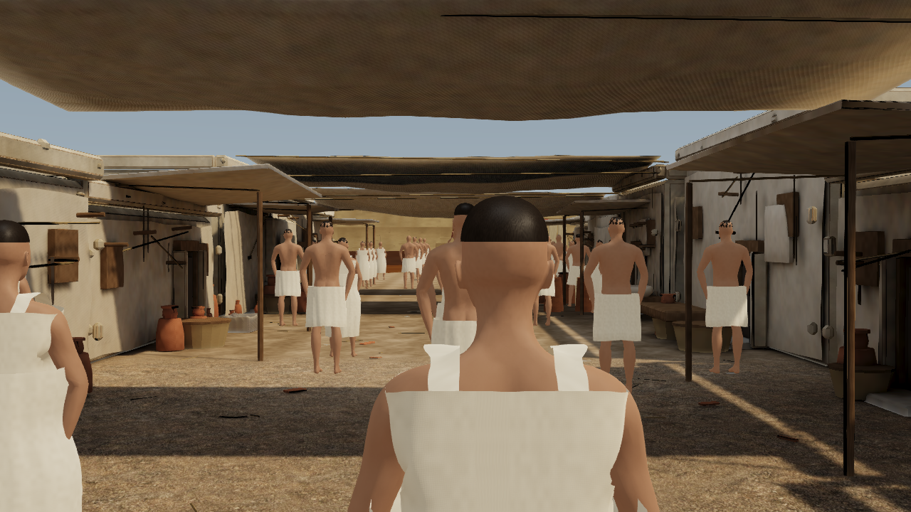
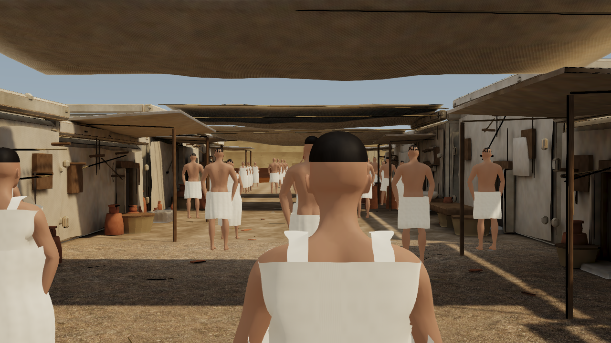

# Character skin, hair and linen: steps 3–4 — 27 October 2026

These are material-only refinements to the accepted character bases from steps 1–2. All 126 residents, 63 task brains, positions, walking behavior, static district geometry, collisions, camera bookmarks and character meshes/rigs are preserved. A new integrity check locks 79 pre-existing runtime/source/data files byte for byte. No deployment or headset testing.

## Delivered changes

**Step 3 — skin and hair.** Replaced the uniform repeating skin color tile with a padded anatomical pigment atlas guided by the existing CC0 unwrap. Warm tissue variation and slight joint/palm/sole variation are pigment, not painted illumination. Pore relief remains a separate fine repeating normal map with lower strength. Skin roughness follows the atlas in cinematic mode. Cropped scalp uses finer strand/clump breakup with a crown field, less glossy response and reduced anisotropy. These remain authored procedural surfaces, not scanned skin or strand-based hair.

**Step 4 — linen.** Calibrated linen toward a neutral warm off-white, reduced exaggerated weave relief and color contrast, added restrained broad fiber variation and tuned roughness/sheen. The accepted clothing shape, fit, length, skin coverage, vertex colors, animation weights and all LOD meshes remain unchanged. Surface polish does not create richer drape or new garment silhouettes.

Nine shared 512×512 maps replace nine maps of the same resolution. Balanced retains six resident maps and scalar roughness; cinematic retains nine and its existing fiber lobes. No new render passes, transmission, per-person material variants or alpha hair cards. Lossless delivery falls from **999,138 to 497,216 bytes (−50.2%)**; texture resolution and resident GPU texture memory are unchanged. Old maps are retained as immutable comparison inputs and are not loaded by the new binder.

## Matched screenshots

The three street views use unchanged stored cameras, viewport and animation time. Male/female portraits use identical temporary inspection camera transforms and actor roots before/after; they do not modify camera bookmarks. Both tiers are captured for each portrait.

| View | Before | After |
|---|---|---|
| Female, balanced |  |  |
| Male, balanced |  |  |
| Female, cinematic |  |  |
| Male, cinematic |  |  |
| Hero street |  |  |
| Street entry |  |  |
| Material view |  |  |

## Performance

Median of three run percentiles, milliseconds (lower is better):

| Tier | Median before → after | p95 before → after | Change median / p95 |
|---|---:|---:|---:|
| Balanced | 39.8 → 41.6 ms | 67.9 → 74.6 ms | +4.5% / +9.9% |
| Cinematic | 59.3 → 59.5 ms | 109.6 → 111.4 ms | +0.3% / +1.6% |

Both fit the existing 10% regression budget for these median-run percentiles. Balanced tail timing is close to that limit and shows run-to-run variation; this is a measured quality/performance tradeoff, not a speedup. Neither tier reaches steady 30 FPS on this hardware. The canonical view retains 391 draw calls and an estimated 388.44 MiB total scene texture allocation in both conditions. All three wide comparisons have identical geometry/draw counts and estimated texture allocation.

[Machine-readable summary](character-surfaces-steps-3-4-2026-10-27.json) and [lossless raw JSON archive index](performance/character-surface/index.json) retain individual runs, phase hashes, matched camera/material checks and exact evidence bytes.

The protocol uses physical Intel HD 4600 / D3D11 at 1280×720, three alternating old/new pairs per tier, 300 simulated seconds of crowd warmup and 600 full-tour frames with the first 61 excluded (539 measured intervals). Only the character material binder is swapped. Phase hashes identify both versions; rendering, AI, meshes, positions and cameras are identical. Benchmark instrumentation restores final source bytes by SHA-256 in `finally`. Run these tools sequentially with builds and captures.

## Validation and reproducible assets

Full production build passes, including historical checks and the new current surface guard. All original body/garment/rig/UV/LOD/source hashes remain unchanged. Source PNG and delivered WebP RGB values match exactly; normal vectors are unit length within quantization error; ORM channels contain unused white AO, linear roughness and zero metallic. Matched capture tooling rejects missing textures and verifies the current material ID, map count, opaque surfaces and correct color spaces in both tiers.

The bounded surface revision preserves the preceding art and older records. Its two immutable baseline files are the binder and the art-revision adapter. `validate:character-surfaces` independently hashes every current map/source and all 79 locked files; old integrity checks continue through the explicit revision adapter. Do not refresh older records to accept new changes. The original people manifest remains the historical v1 material recipe; `surfaces-v2/manifest.json` and the active binder define this pass.

```powershell
# Python requires NumPy and Pillow; use the bundled runtime or an equivalent env.
python tools/build-character-surfaces.py
python tools/verify-character-surfaces.py
node tools/record-character-surfaces.mjs
npm run build
node tools/capture-character-surfaces.mjs
node tools/benchmark-character-surfaces.mjs --crowd-warmup --runs=3 --label=character-surface-tour
node tools/benchmark-character-surfaces.mjs --crowd-warmup --runs=3 --quality=cinematic --label=character-surface-cinematic
node tools/report-character-surfaces.mjs
```

Editable PNGs, the deterministic generator, original Blender geometry, PBR color-space/UV settings and provenance are retained for future Unity/Unreal adaptation. No engine-specific shader or lighting equivalence is claimed. More detailed facial sculpting, hair silhouettes/style diversity, cloth drape and richer hand interactions remain necessary for the cinematic references.
