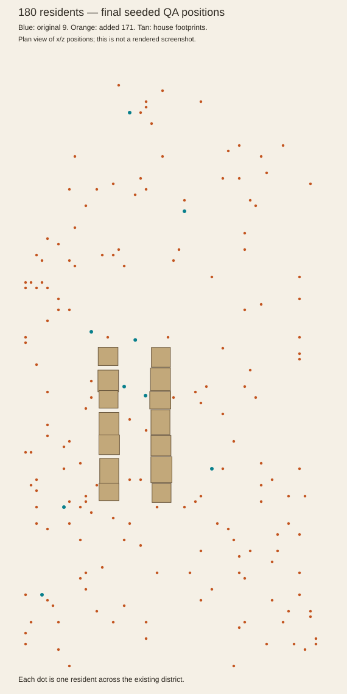
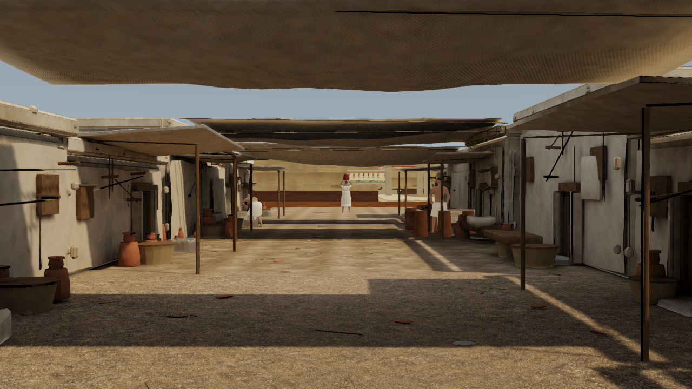
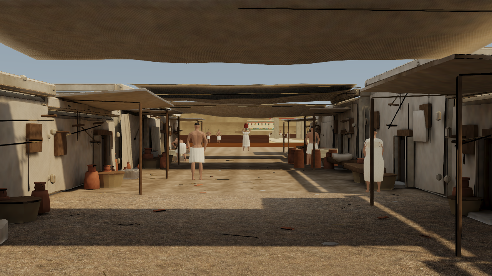
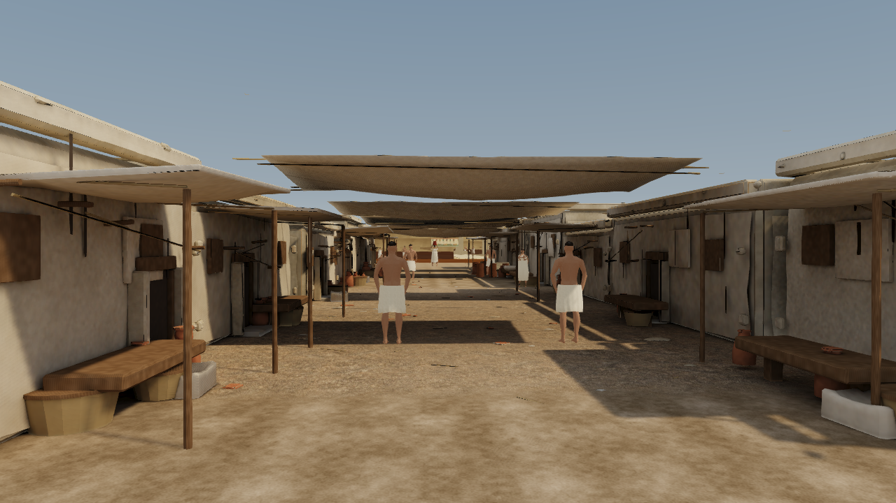
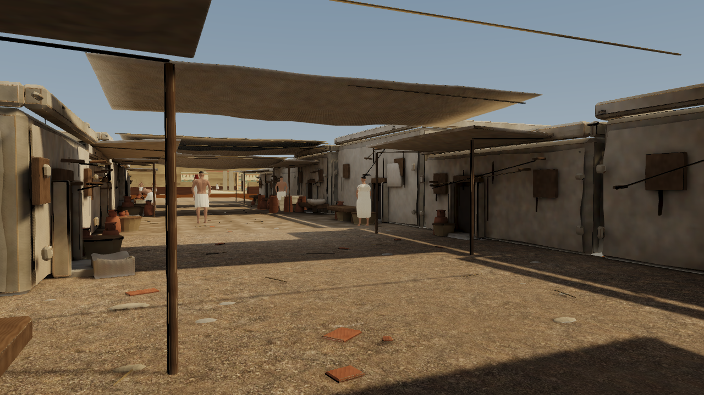
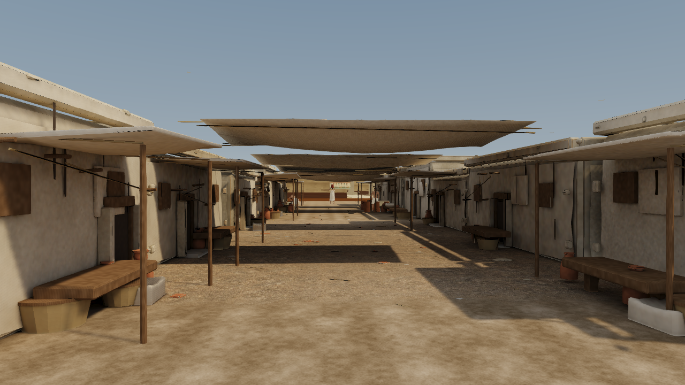

# Crowd and image clarity — 26 October 2026

The local scene now contains **180 people, twenty times the previous nine**. The additional 171 share the existing licensed anatomy and PBR materials through GPU instancing and two pose atlases. The original nine retain their live rigs and ground-contact IK. Building layout, camera bookmarks, ground support and house/temple colliders are unchanged. No deployment was performed.

## Image quality

FXAA retains its edge search but uses 0.5 subpixel smoothing instead of 1.0, with stronger coherent-edge detection. Luma-clamped detail enhancement is reduced from 0.20 to 0.12 to limit halos and brittle thin lines. This is one resolve pass, with no separate sharpen pass, supersampling, blur or depth-of-field masking.

Ground colour now uses 8x anisotropic filtering at oblique angles; other authored colour maps retain 4x balanced / 8x cinematic. Normal/physical maps retain 2x balanced / 4x cinematic, and lightmaps retain 2x. Trilinear mipmaps remain intact. Raw bone and crowd-pose textures are excluded from surface filtering and retain exact nearest sampling. Cinematic still uses MSAA4; balanced stays single-sample plus FXAA.

These are incremental improvements. FXAA cannot straighten genuinely curved or uneven mesh silhouettes, and the authored cloth sag remains. This does not establish reference-level cinematic fidelity or temporal antialiasing.

## Crowd rendering and movement

The glTF actor hierarchy reflects Z. Matching the sign of instance-source transforms prevents Babylon's per-instance winding fallback. The rejected first crowd candidate measured 116.4 / 187.7 ms p50/p95; correcting batching reduced its median draw calls from 778 to roughly the original street's range.

Additional residents retain full anatomy within 8 m. Real skinned replacements are used at 8 m and 20 m, never null/hide LODs. Female geometry is 33,371 → 9,746 → 2,638 triangles; male geometry is 30,594 → 8,971 → 2,365. UVs, vertex colours, named joints, weights and compatible inverse binds are checked. Source Blender files and the generator are retained. No building or original-character geometry was simplified.

The distant body LODs use four bone influences after comparing 16 articulated test poses against their eight-weight exports: body p99 errors below 0.15 mm and maximum below 3.7 mm. Clothing weights are unchanged. Existing full-detail meshes are untouched. Idle residents share one identical pose row; locomotion uses 64 distance-driven samples and five walk/idle blend levels. Added residents follow the existing flat-ground contact animation; they do not run 171 additional live foot-IK solvers.

Spawns are spread over the walkable navigation graph with initial clearance. Added residents choose district-wide goals with fewer shared purpose-zone goals. Existing bounded turns, acceleration, spontaneous pauses and collision avoidance remain. Spatial neighbor buckets replace quadratic all-pairs searches; at most four route searches start each update. Entropy drives production decisions and QA uses a seed. Finite-space travel may revisit places; no mathematically non-repeating-path claim is made.

## Intel HD 4600 performance

Three interleaved controls/finals; 600 full-tour frames, 61 excluded initial frames, 300 simulated seconds of seeded crowd warm-up. Same 1280x720 camera route and HD 4600 D3D11. Controls use nine people and the previous resolve/filter policy; finals use 180 and the enhanced policy.

| Variant/run | p50 ms | p95 ms | Median draws |
|---|---:|---:|---:|
| control 1 | 31.6 | 55.2 | 216 |
| final 1 | 49.7 | 77.7 | 251 |
| control 2 | 37.3 | 62.4 | 216 |
| final 2 | 50.3 | 74.3 | 251 |
| control 3 | 34.4 | 61.6 | 216 |
| final 3 | 48.4 | 73 | 251 |
| Median control | 34.4 | 61.6 | 216 |
| Median final | 49.7 | 74.3 | 251 |

Median frame-time cost: **44.5% p50 / 20.6% p95**, including the requested 20x crowd. These controls isolate the previous nine-person experience on the current code, not historical captures taken under different machine load. The result still has stalls and does not demonstrate sustained 60 FPS. New LOD downloads total 2.69 MiB, plus two runtime float pose atlases. Headset testing remains deferred.

One cinematic smoke run: 73.7 / 114 ms p50/p95, 180 people. This is not a repeated cinematic comparison.

## Validation

Full production build and inherited integrity checks pass. Crowd audit: 17 checks, including count, exact pose sampling, batching, real LODs, support, movement, spacing and facing. Existing nine-person movement/hand/grounded-flight regression: 78 checks; house/temple collision audit: 26 checks. All pass. The original regression runs with crowd=small; the separate crowd audit checks all 180 residents. Three locked views preserve exact camera positions, viewport and district-root transforms.

## Population distribution

This plan view plots all 180 final QA residents across the existing district. Tan boxes are the unchanged house footprints; dots are actual world positions. It helps distinguish district-wide population from the smaller number visible in one street view.

## Matched views

### hero-street-main

Before: nine people, previous resolve. After: 180 distributed residents, new resolve. Identical camera and district roots.

### street-entry

Before: nine people, previous resolve. After: 180 distributed residents, new resolve. Identical camera and district roots.

### hero-street-material

Before: nine people, previous resolve. After: 180 distributed residents, new resolve. Identical camera and district roots.

## Isolated image-quality comparison

The following view keeps nine people in both versions so the changed edge resolve and ground filtering can be judged separately from population.

## Reproduce

- Build: npm run build.
- Derive LODs: Blender 5.1 --background --python tools/blender/build_crowd_lods.py. Check with tools/verify-crowd-lods.py (NumPy Python).
- Runtime diagnostic controls: crowd=small restores nine residents; clarity=previous restores the previous resolve and ground-colour filtering. These are comparison controls, not a change to camera or district data.
- Capture: node tools/capture-hero-shot.mjs crowd-clarity-after --hardware --all.
- Crowd audit: add --audit-script=tools/audit-crowd-clarity.js. Existing regression adds --small-crowd --collision-audit --audit-script=tools/audit-district-interactions.js.
- Benchmark: node tools/benchmark-rendering.mjs --optimized-only --runs=1 --crowd-warmup --label=<label>. Control adds --small-crowd --previous-clarity. Run controls/finals in interleaved order, without simultaneous builds or captures.

The new crowd/clarity revision layer preserves all original snapshots and checksums. Do not refresh old locks to conceal differences. The JSON report links every timing sample and records all audit results.
