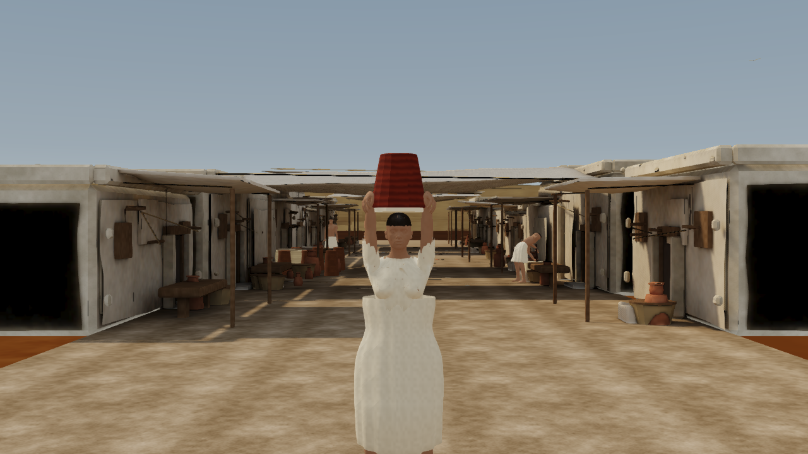
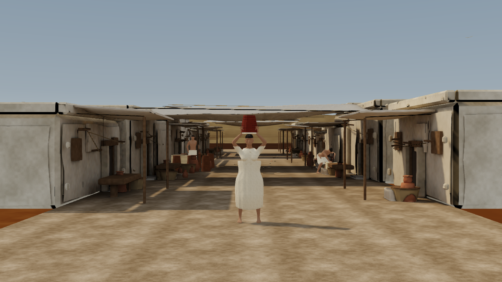
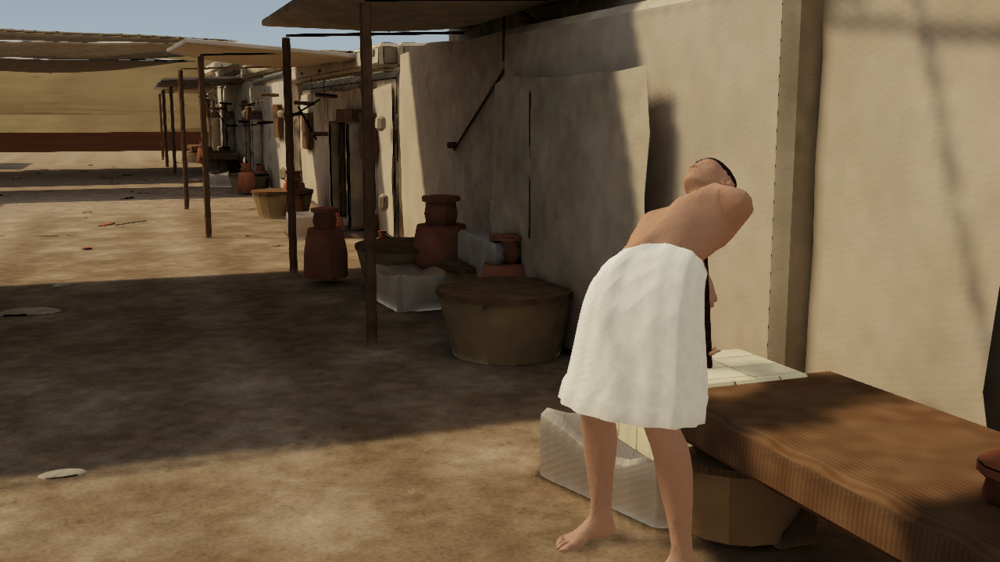
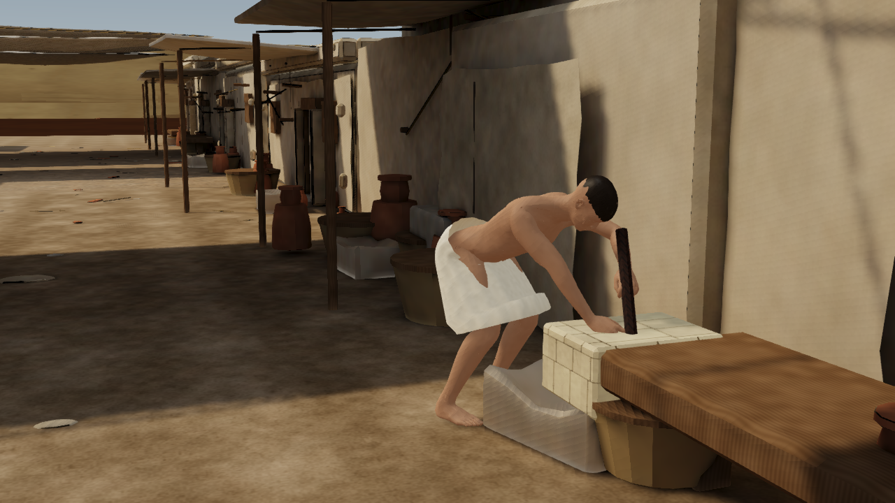

# District interaction and exterior repair — 25 October 2026

Implemented the user's seven requested corrections. The new request for free district-wide movement supersedes the earlier fixed NPC paths. Building placement, district geometry positions, camera bookmarks and guided route data remain protected.

## Result

- Nine anatomical characters: the existing three plus six residents distributed at the riverside, gate, open yard, crafts area, temple approach and court. Eight roam; the craftsman works and rests at a stationary block. Existing character models and PBR textures are shared.
- Fourteen house footprint colliders replace the incomplete street-side rails. All four sides of each existing house are solid; the previously cleared temple approaches remain open. These houses have closed, non-enterable interiors.
- Corrected 594 inward-facing plaster end-panel faces throughout all three street chunks. A 4 cm outward bake-only sampling shell repairs their original UV charts. Sky and sun bounce remain linear and separate from albedo/direct sun. No channel clips; pixels outside the repair masks are unchanged. Across 195,178 high-mesh triangles, the unique vertex-position/lightmap-UV sets and triangle counts are unchanged. Actual seam-preserving LODs were re-exported.
- Destination planning over 4,972 supported navigation nodes replaces sinusoidal loops. Production decisions use fresh cryptographic entropy, recent-destination memory, random purpose zones, pauses, glances and obstacle-aware routes. QA alone uses a reproducible seed. Paths may revisit streets naturally; this is varied destination-based behaviour, not a guarantee of never repeating in a finite district.
- Walking follows the smoothed body heading, with bounded turns, acceleration/deceleration, local avoidance and a 65 cm minimum center separation. Nobody translates backwards relative to body facing.
- Arms use an arm-specific two-bone solve, relaxed fingers and limited wrist bend. The worker has a small crouch, reachable contacts near the block edge and blended work/rest poses. Tool orientation is independent of wrist flexion. Existing ground-contact IK remains active.
- Walking stays horizontal regardless of view pitch and tracks the floor surface. Hold **F + WASD/arrows** for collision-aware view-directed flight. While F is held, Space rises and Ctrl descends. Release F to land; if over a roof/water/unsupported point, return to the last safe walking position. Losing focus clears held flight. The HUD explains the controls.

## Verification

78 live interaction checks and 26 existing collision checks pass, including all 56 house-side tests, temple floors/joins, open approaches, looking up/down while walking, held flight, landing and below-ground recovery. The navigation run covers six simulated minutes; a further 20 seconds exercises full-rate work/rest pose transitions.

- Minimum velocity/body-facing dot: 0.999999999999999.
- Maximum turn rate: 1.6000000000000003 rad/s.
- Minimum resident separation: 0.6507156954827278 m.
- Maximum wrist angle: 34.9 degrees.
- Settled working contacts: {"maxHandError":0.012729290811108383,"handSamples":588} (metres).

The complete production build passes content, history, budgets, geometry/UV, camera/layout, actor, character, renderer, finish and interaction guards, plus both workspace builds. The existing Vite large-chunk warning remains.

## Matched views

Both pairs use the same absolute camera, viewport (1280 × 720), quality tier and QA time. Before uses archived street assets and the legacy population/pose branch; after uses the final normals, bake and behaviour. A resident/worker's motion may differ because the new controller replaces the former loops. Final assets are restored and hash-verified by the comparison harness; the benchmark harness separately restores its temporary source instrumentation.

| View | Before | After |
|---|---|---|
| Exterior ends |  |  |
| Working hands |  |  |

The three existing locked camera captures are also saved with the district-finished suffix.

## Intel HD 4600 desktop performance

Three fresh hardware Chrome sessions per tier, 600 rendered frames per full-tour run, 61 initial frames excluded, five simulated minutes of deterministic crowd warm-up before measurement. Nine residents are present in every run. Values below are medians of the three run percentiles; raw runs, renderer and actual render dimensions are in the companion JSON. No headset result is claimed. These are current measurements, not a controlled speedup comparison with earlier three-person runs.

| Tier | Frame interval p50 | Frame interval p95 |
|---|---:|---:|
| Balanced | 38.6 ms | 66.5 ms |
| Cinematic | 57.6 ms | 108.8 ms |

Far residents evaluate limb poses at 15 Hz beyond 35 m. Extra resident shadow casting uses 24/30 m hysteresis; the original three keep their existing shadow-casting range. Avatar geometry, materials and texture residency are shared. No resolution or material-quality reduction was introduced for these fixes.

## Reproduction and source preservation

- Run `npm run build` and `npm run qa:district-interactions` with the dev server on port 5573.
- Run `node tools/capture-district-comparisons.mjs` for both matched pairs and the original camera bookmarks. It temporarily swaps only the archived visual files and restores all final bytes in a finally block.
- Run `node tools/benchmark-rendering.mjs --optimized-only --runs=3 --quality=balanced --label=district-life-balanced --crowd-warmup`, then the same with cinematic and label district-life-cinematic. The harness restores main/scene sources and verifies their hashes. Do not run other captures/builds while its temporary instrumentation is active.
- Run `node tools/report-district-interactions.mjs` to regenerate this report from evidence.
- `npm run repair:exteriors` regenerates the corrected source, focused bakes, maps and LODs; set BLENDER_BIN/PYTHON_BIN as needed. Python requires NumPy and Pillow. The promoted street-finish pipeline invokes this correction automatically. The generator now gives each end skin its correct outward winding.
- Editable geometry is in `content/source-assets/lighting/exterior-repair/exterior-corrected.blend`; unclipped linear sky/bounce arrays, UV masks and immutable pre-fix visual inputs are beside it. Runtime glTF, PBR maps, scale and provenance remain available for later engines.
- `district.interaction-revision.json` records this explicitly authorized change above the prior locks. Original snapshots and hashes remain intact; do not overwrite old locks to hide a regression. Navigation footprints/spawns are separate metre-based data. Browser controllers will need native equivalents when integrating another engine.
