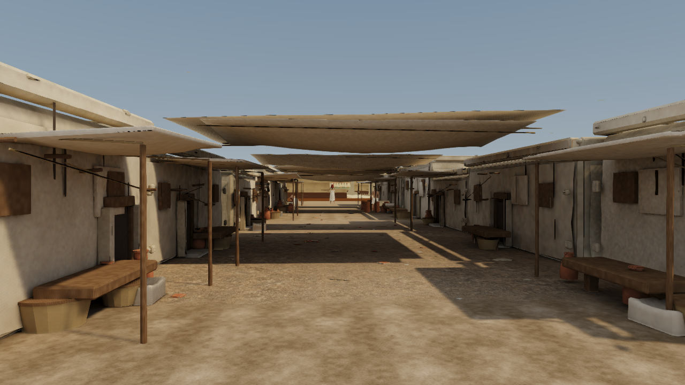
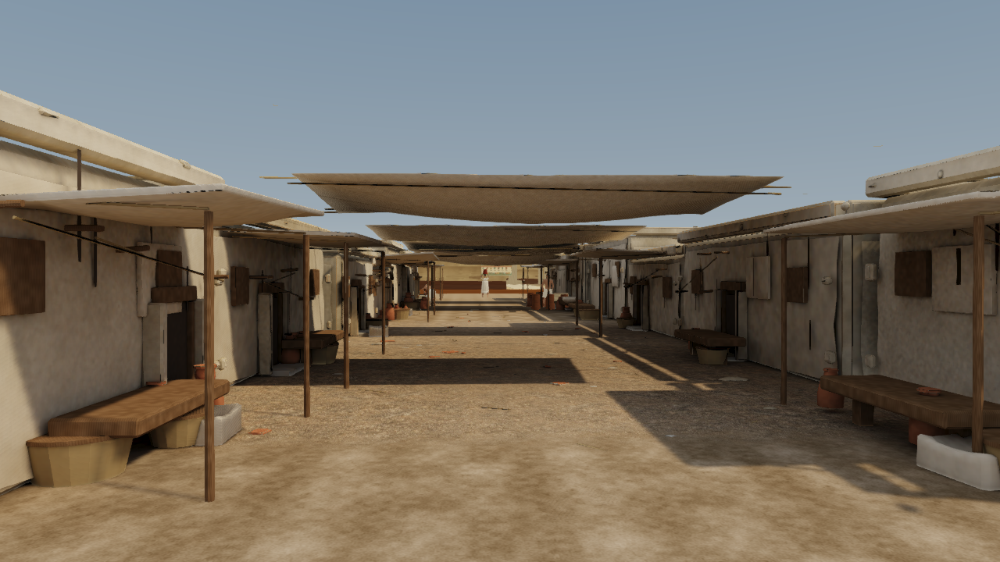
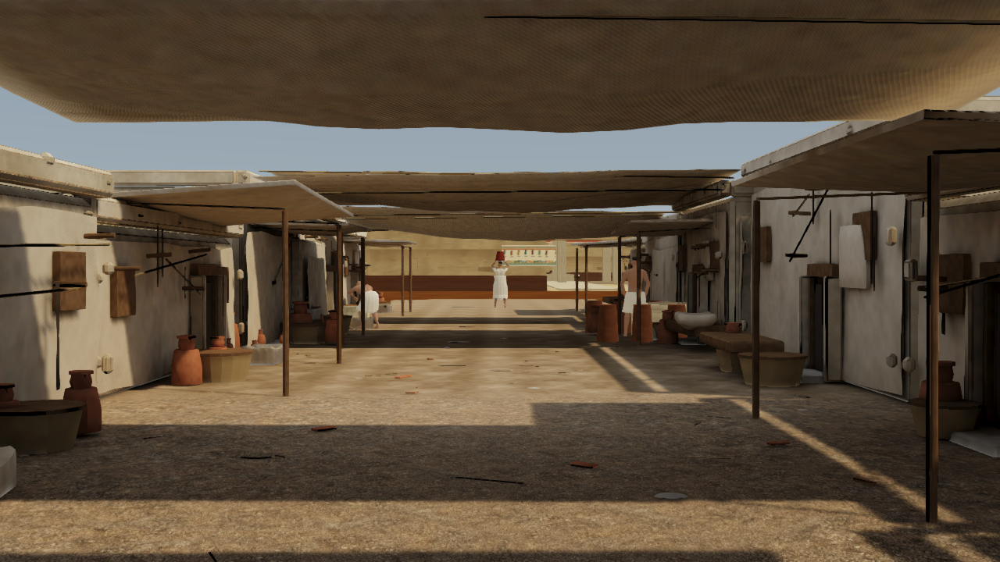
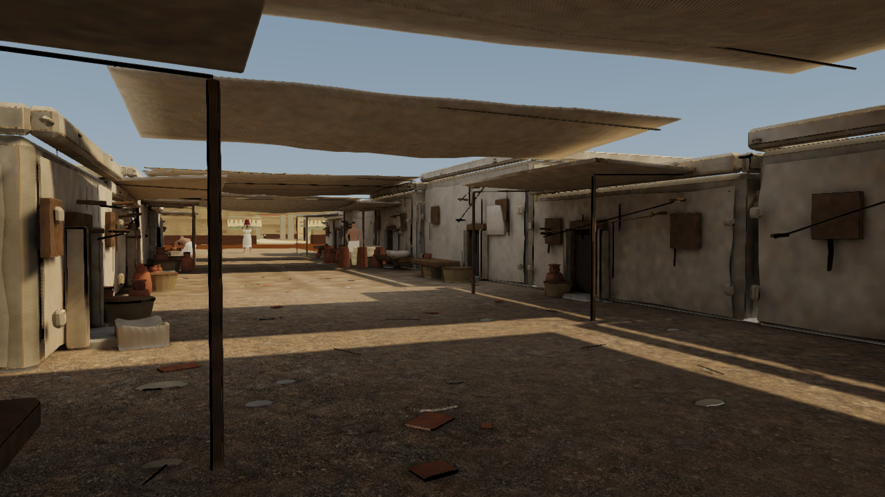
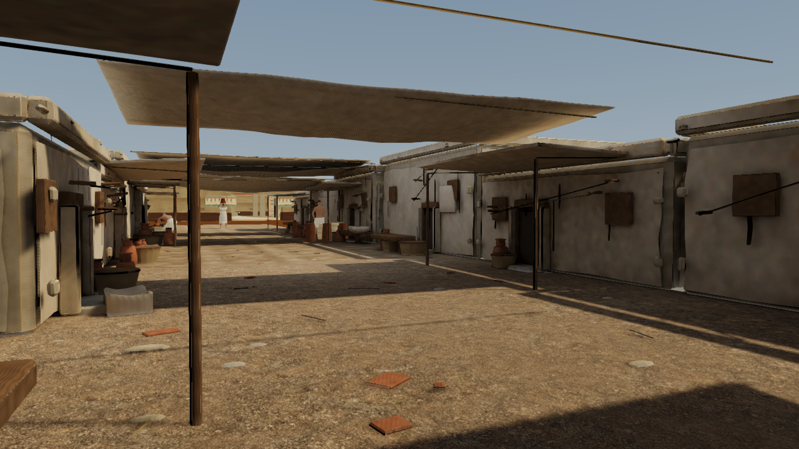

# Hero street image-quality repair — 25 October 2026

This pass addresses the reported stair-step edges, texture clarity and crossing canopy surfaces. Building placement, camera bookmarks, walking paths, collision boundaries, character models and their behaviour remain unchanged.

## Changes

- Balanced uses a coherent-edge FXAA resolve with gentle, luminance-clamped detail enhancement in the same pass. Existing cardinal samples are reused; visually flat pixels return directly. Strong edges receive AA rather than sharpening. There is no extra sharpening render target or supersampling.
- Authored PBR colour maps use 4× anisotropic filtering in balanced and 8× in cinematic, bounded by hardware support. Existing normal/physical maps retain 2× in balanced and 4× in cinematic; lightmaps stay at 2× to protect atlas gutters. Trilinear mip filtering and the full mip chains remain enabled. Unrelated generated fallback textures retain their prior filtering levels.
- Cinematic retains its existing 4× MSAA. The trial adding balanced 2× MSAA plus a separate sharpening pass was rejected after a large measured frame-time regression.
- The desktop near clip increases from 4 cm to 10 cm, improving depth precision for close overlapping surface details. The 512 m far clip covers the authored district. Camera positions, aim and lens values remain fixed.
- Two older upper cloth skins crossed the retained hero canopies. Exactly 1,760 redundant triangles were removed from the middle chunk. All retained high-mesh vertex/UV sets and object transforms are unchanged. The affected real LODs were re-exported. The existing indirect-light maps remain; direct sunlight shadows follow the corrected geometry.
- The angular route overlay is opt-in with `?routeGuide=1`, so it no longer draws over the normal scene floor. The guided route data and camera travel are unchanged.

## Matched visual evidence

All three main comparisons use the same absolute camera, 1280 × 720 viewport, balanced tier and frozen QA time. Nine characters load in every view.

| View | Before | After |
|---|---|---|
| street-entry |  |  |
| hero-street-main |  |  |
| hero-street-material |  |  |

The separate route-overlay pair uses the same enhanced renderer and normal UI: [overlay before](screenshots/street-entry-image-quality-route-before.png) / [overlay after](screenshots/street-entry-image-quality-route-after.png).

## Intel HD 4600 measurements

Three interleaved control/final pairs use the same corrected geometry, nine residents, native 1280 × 720 rendering, a five-minute deterministic crowd warm-up and 600-frame full-tour sampling. Initial 61 frames are excluded. The control uses the former rendering/filter settings; the final uses the new resolve and selective filtering. Values are medians of three run percentiles. Absolute frame times vary with desktop load; this comparison measures incremental overhead rather than a speedup against older batches.

| Balanced | Frame p50 | Frame p95 |
|---|---:|---:|
| Rendering control | 48.7 ms | 79.9 ms |
| Final quality | 50.8 ms | 81.5 ms |
| Change | +4.3% | +2% |

A separate cinematic full-tour smoke test measured 57.1 ms p50 / 87 ms p95 with effective 4× MSAA. This is one run, not a repeated performance comparison. Headset testing remains deferred. The HD 4600 does not sustain 60 FPS in this scene.

## Verification and reproducibility

- 104 live movement/collision checks pass, including house walls, temple floors, held-F flight/landing, spontaneous navigation, forward movement, spacing and working-hand contacts.
- Live checks at all three locked views confirm one AA resolve, no extra sharpen pass, the compiled shader variant, nine loaded characters, sampler levels, mip chains and trilinear filtering.
- The native depth optimization remains in place. Its colour-output comparison is pixel-identical against the unoptimized rendering control.
- Full production build passes all historical content, layout/camera, character, material, renderer, finish, interaction and image-quality integrity guards. The existing Vite large-chunk warning remains.
- `npm run validate:image-quality` checks the bounded revision and pinned vendor FXAA. `tools/verify-image-quality-geometry.py` verifies the exact cloth retirement and retained geometry. `tools/audit-image-quality.js` checks the live GPU setup through the capture harness.
- The original source/visual bytes are preserved under `content/source-assets/image-quality-baseline/`. `hero-street.image-quality-revision.json` extends the earlier integrity layers without replacing their baselines.
- Editable cloth geometry is in `content/source-assets/image-quality/cloth-corrected.blend`. `npm run repair:exteriors` now chains the overlap correction and geometry verification after the exterior bake, preserving current lighting metadata. Set BLENDER_BIN/PYTHON_BIN as needed; Python uses NumPy/Pillow.
- The resolve derives from the installed Babylon FXAA through a separately named shader and public post-process API. Vendor files are untouched, and their hash is pinned for upgrade review. Failed shader compilation falls back to native FXAA.
- Raw run metrics, the image-setting audits and all camera comparisons are in the companion JSON. Asset detail still sets the limit for close-up realism.
