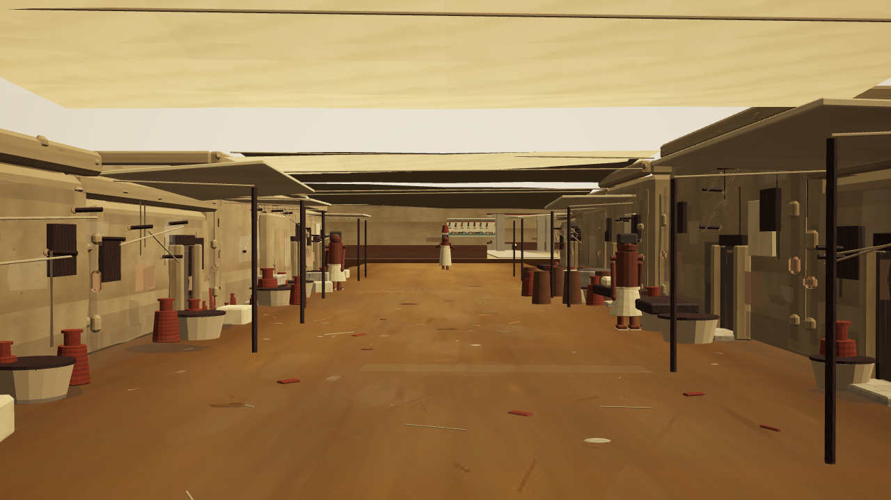
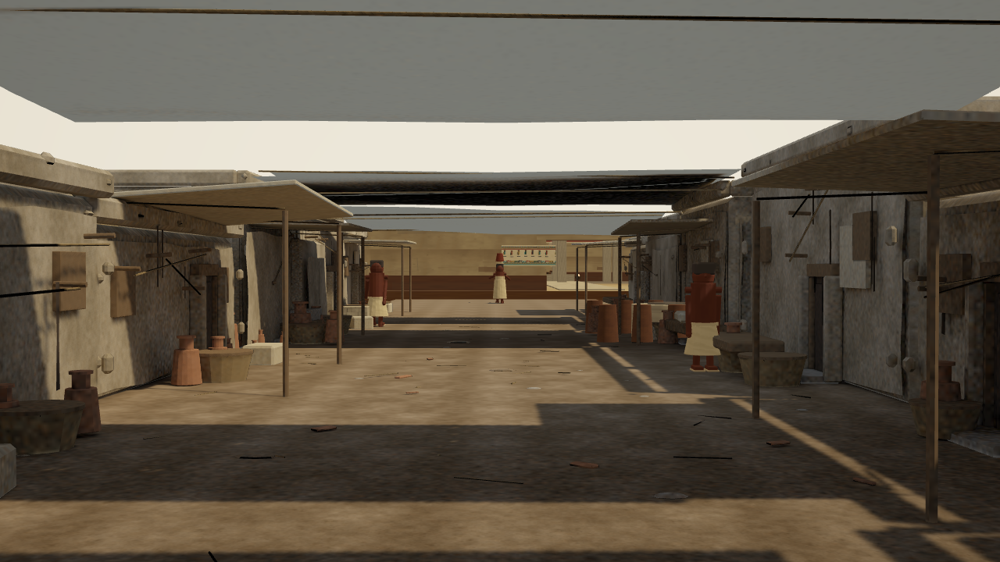

# Hero street material and lighting pass — 2026-10-22

Scope: first implementation of assessment steps 1–4. Existing district, route,
building positions, canonical camera and diagnostic cameras remain locked.
This is an incremental realism pass, not a claim that cinematic quality is done.

## Implementation

- Deterministic QA mode (`qa=1`) fixes ambient motion at two seconds and pauses
  GLB animation at a fixed frame. It waits for scene readiness and 30 rendered
  frames; captures include a JSON sidecar with camera, dimensions, bake ID,
  draw calls, active indices, vertices and estimated texture memory.
- The capture script reads the camera-lock viewport/port, rejects missing hero
  chunks, and preserves named before/after images instead of overwriting the
  old canonical reference. SwiftShader captures are visual tests, not hardware
  performance benchmarks. Texture memory estimates assume RGBA8 plus mipmaps.
- New project-authored synthetic dust/plaster maps have consistent albedo,
  height-derived normal, and ORM channels. World-scaled UV0 uses a two-meter
  repeat. No reference image pixels or externally sourced assets are included.
- `tools/blender/bake_hero_street.py` imports the existing checked-in street
  chunks, removes the old transparent fake shadow/haze/grime sheets, welds
  duplicate vertices, and makes an independent packed lightmap UV set.
- Cycles bakes actual geometric sky illumination and sun bounce into three
  linear irradiance atlases. Direct sun is excluded and supplied by Babylon's
  real-time shadow generator, including existing animated actors.
- Each material is bound by an explicit exported material ID table. The PBR
  ambient channel multiplies irradiance by albedo; normals and roughness respond
  to real-time sun. Legacy hemisphere/bounce lights exclude the baked street.
- Authored outputs live under `public/assets/authored/hero-street/`. Ordinary
  `generate:assets` and `build` never regenerate them. The editable Blender source
  is saved under ignored `content/generated/hero-street-bake.blend`; the tracked
  generator and original GLBs reproduce it.
- The handoff's stale camera coordinates were synchronized to the existing V5
  JSON. The camera JSON itself and route data were not edited.

## Commands

```powershell
npm run dev
npm run qa:hero-capture -- cinematic-before --all --legacy
npm run bake:hero
npm run validate:hero
npm run qa:hero-capture -- cinematic-after --all
npm run build
```

`BLENDER_BIN` can select the installed Blender executable. `EGYPTVR_BAKE_SIZE`
and `EGYPTVR_BAKE_SAMPLES` override the default 2048px / 24 sample bake. Rebuild
all chunks together because every chunk participates in occlusion and bounce.
Changing the sun direction requires rebaking its indirect contribution.

Comparison URLs:

- Updated: `http://127.0.0.1:5573/?shot=hero-street-main&chrome=0&qa=1`
- Generated baseline: append `&materials=legacy`.
- Normal walkthrough: omit `qa=1` to restore animation.

## Portability and constraints

`manifest.json` documents meters, glTF, UV sets, normal convention, channel
packing, linear lighting, source hashes, and locked camera/route hashes. The
UVs, geometry, maps and editable source can feed another engine. Unity/Unreal
still need importer/shader adapters; this pass does not claim engine parity.

The new validation gate checks source and lock hashes, unchanged chunk
transforms, UV1 presence, material bindings, irradiance dimensions and separate
authored delivery budgets (7 MB geometry / 20 MB runtime maps). Existing legacy
asset budgets remain in force. The authored tier adds download and GPU memory;
headset and laptop hardware profiling is still required.

Remaining visual limitations: primitive human anatomy/animation, angular prop
silhouettes, repeated building forms, synthetic rather than scanned materials,
and limited baked lighting resolution. Future passes should improve the nearest
facade/prop geometry and human assets; adding more street content is unnecessary.

## Visual comparison

| Before | After |
| --- | --- |
|  |  |

Diagnostic comparisons use `street-entry-cinematic-{before,after}.png` and
`hero-street-material-cinematic-{before,after}.png` in the same directory.

## Verification results

- Root production build passed, including all content/history/optimization and
  authored bake checks. Vite reports a large-bundle warning; code splitting is
  still an optimization task.
- Browser/shared TypeScript checks passed. `git diff --check` passed.
- Authored GLBs total 5.42 MB; nine runtime maps total 18.04 MB. The locked hero
  capture reports approximately 304 MiB of RGBA8-equivalent texture storage
  including the rest of the scene and mipmaps; this is not measured GPU residency.
- The initial all-direct baked trial was rejected for excessive darkness.
  The accepted implementation separates real-time direct sun from baked sky and
  bounce. Bump strength and shadow bias were then reduced/tuned to avoid a grainy
  sunlit surface read.
- No headset or target-laptop hardware benchmark was performed. Character and
  prop silhouettes still clearly reveal the prototype asset quality.
