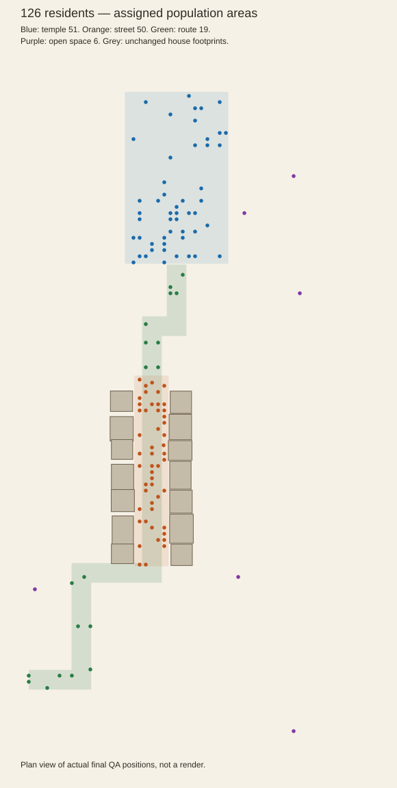
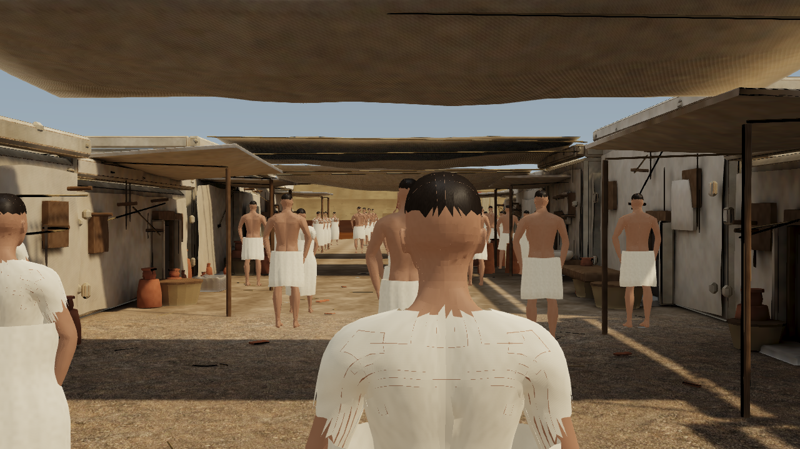
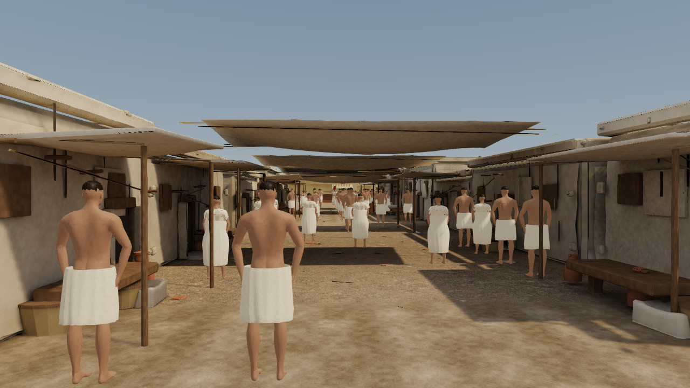
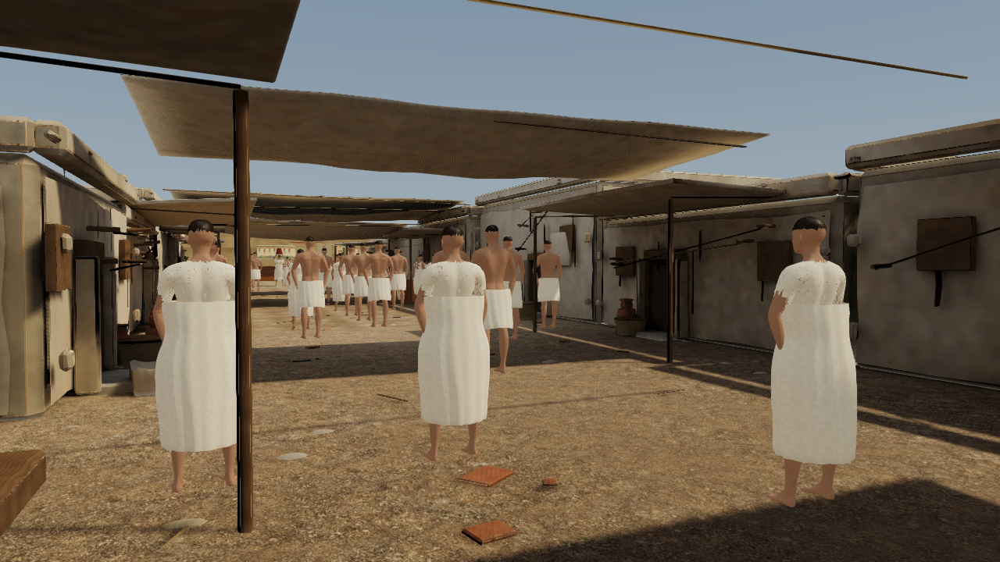
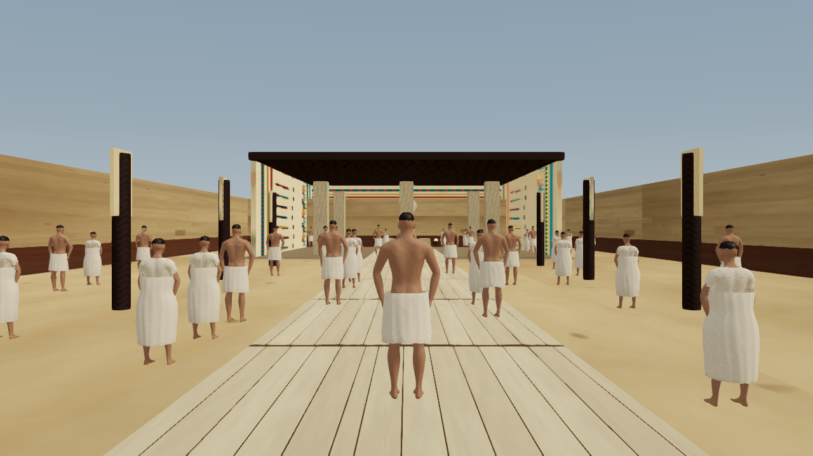

# Population areas and grounded step-up — 27 October 2026

Default population is **126**, a 30% reduction from 180. Distribution uses persistent, mutually exclusive areas, not just a weighted spawn pass.

| Area | Requested | People | Actual share |
|---|---:|---:|---:|
| temple | 40% | 51 | 40.5% |
| street | 40% | 50 | 39.7% |
| route | 15% | 19 | 15.1% |
| free | 5% | 6 | 4.8% |

Whole-person allocation uses largest-remainder rounding. The temple/street fractional tie gives the extra person to the temple, following configuration order. Definitions are editable in content/scene-data/district-population.json.

## Where people go

- Temple: inside the existing Ptah enclosure, courtyard and shrine, x −12.6…12.6, z 49.2…91 m. Walls and pillars still constrain navigation.
- Village: the lane between existing house fronts, x −10.3…−1.95, z −24.4…22 m. This includes the end approaches and the craftsman's existing work station.
- Route: a 2.4 m half-width corridor around the existing arrival-to-temple waypoints. Temple and village take priority where regions overlap; route residents occupy the remaining approach sections.
- Open: other connected walkable space. The river-side world boundary and building collisions remain.

Each person chooses spontaneous goals and pauses within their assigned connected area. Pathfinding, shortcuts, detours and actual movement all enforce the same boundary, so quotas hold over time. Route sections separated by the village are separate local wandering components; this is area occupancy management, not a promise that each route resident walks the entire tour. The craftsman remains at the nearest safe standing point beside his original work block. Original close characters, GPU animation, materials and rendering tiers are retained; the additional GPU population is now 117.

Higher local density exposed two avoidance defects: lateral neighbors could stop motion unnecessarily, and blocked paths could accumulate stale detours. Residents now distinguish turning from blocking, permit safe lateral passage, and replace a blocked intention with a clear side-step or a turned, forward-facing retreat. The 65 cm hard clearance and 1.6 rad/s turn bound remain.

## Arrival blockage and step-up fix

The quay already had a real 34 cm collision box, and the ramp was tilted collision geometry. The old support service ignored both and kept restoring the visitor to the underlying ground. The capsule consequently collided with the raised edge without receiving a supported step-up.

Navigation now includes the quay and the actual ramp plane, rather than using the ramp's maximum AABB height everywhere. VisitorTraversal additionally probes collision surfaces beneath the capsule and just ahead of travel. Automatic step-up is bounded to **38 cm**, requires overhead clearance and keeps a short leading/trailing-foot lift while crossing the riser. Native swept-ellipsoid collision and wall sliding remain active. The visible eye height moves smoothly while the physical capsule receives the clearance it needs. Tall walls and oversized obstacles remain solid.

No jump key is needed for these low steps. F + movement remains the deliberate flight override; release lands safely. Looking up/down does not turn walking into flight. Below-ground recovery and unsupported-edge protection remain. Stored camera bookmarks, route data, building geometry and colliders are unchanged.

## Direct before/after reproduction

The comparison temporarily loads only the immutable pre-change camera/navigation sources, then restores current bytes in finally with SHA verification. Both versions start at [-30,1.7,-49.999], face across the same quay and hold W for 90 rendered frames. Timing varies, so this is a traversal test, not a speed comparison.

| Result | Before | After |
|---|---:|---:|
| Quay support height | 0 m | 0.34 m |
| Final x position | -32 m | -36.3 m |
| Blocked at quay | false | false |
| Maximum eye height | 1.7 m | 2.04 m |

Raw proof: arrival-crossing-comparison.json. The actual quay and ramp also pass the combined live suite in both travel directions. In the control, the reliable defect is missing raised-surface support; complete stalling can depend on the initial capsule overlap and frame timing. The raw blocked-at-edge flag records what occurred rather than assuming every control run freezes.

## Verification

**129 live checks pass**: 25 new zone/step checks, 78 retained movement/hand/grounded-flight checks and 26 house/temple collision checks. The new suite tests all 126 residents over three simulated minutes, including exact quotas at every sample, no building crossings, minimum personal clearance, forward-facing travel and continued movement. An extra full-pose interval checks working hand contacts.

Physical tests cover the real quay and tilted ramp, 20/35 cm up/down steps, a blocked 60 cm obstacle, low headroom, continuous-wall sliding, held-F flight, landing and below-ground recovery. The retained interaction suite uses the nine-person diagnostic mode; the new suite separately exercises the full population. The complete production build and inherited asset/layout/camera integrity checks pass.

One HD 4600/D3D11 full-tour smoke run at 1280×720: **61.9 ms p50 / 111.6 ms p95**, 539 measured frame intervals after 61 initial frames, with 300 simulated seconds of crowd warm-up. This is not a repeated or paired performance comparison. Concentrating residents changes how many are visible in a view, so the reduced global count alone does not establish a speedup.

## Final views

The three existing bookmarks retain their exact positions, viewport and static district roots. These screenshots show the new allocation, so NPC positions intentionally differ from the previous diffuse population.

### hero-street-main

### street-entry

### hero-street-material

### Temple diagnostic view

This temporary inspection camera shows the courtyard population. No stored camera definition was edited.

## Reproduce

- npm run build includes validate:zones-steps alongside all earlier guards.
- node tools/capture-hero-shot.mjs zones-steps-after --hardware --shot=street-entry --audit-script=tools/audit-zones-steps.js
- node tools/compare-arrival-crossing.mjs reproduces the original blockage, verifies the fix and restores source bytes. Do not run it concurrently with builds/captures/benchmarks.
- node tools/benchmark-rendering.mjs --optimized-only --runs=1 --crowd-warmup --label=zones-steps-tour
- node tools/report-zones-steps.mjs regenerates this report from saved evidence.

The new revision layer preserves the original crowd/clarity and interaction snapshots. No lighting, texture, mesh-layout or stored camera changes were made. Headset qualification remains deferred. Changes are local; no deployment was performed.
